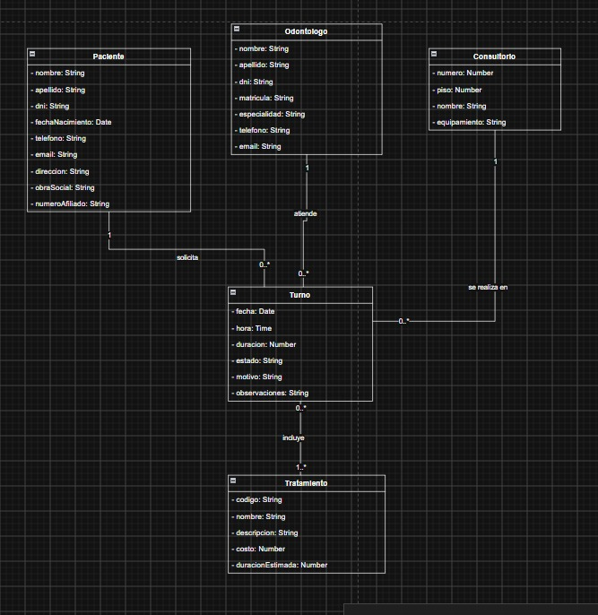

# Dental Care – API

Trabajo Integrador Final – Tecnicatura Universitaria en Programación (UTN FRRo).
Integrantes: Amaya Lara, Burgos Benjamín, Mendez Matías, Wilson Sebastián.

API REST para gestionar los turnos de un consultorio odontológico: pacientes, odontólogos,
consultorios, tratamientos y turnos, con autenticación JWT por roles.

## Arquitectura (Clean Architecture)

| Proyecto | Responsabilidad |
|---|---|
| `DentalCare.Domain` | Entidades, enum `EstadoTurno`, roles, excepciones de dominio e interfaces de repositorios. No depende de nadie. |
| `DentalCare.Application` | DTOs, interfaces y servicios de negocio (reglas de turnos, autenticación). Depende de Domain. |
| `DentalCare.Infrastructure` | `DentalCareDbContext` (EF Core + MySQL/Pomelo, code first), repositorio genérico + específicos, migrations, JWT, hashing de contraseñas y cliente HTTP de feriados. |
| `DentalCare.Web` | Controladores, `Program.cs`, manejo global de errores, Swagger. |
| `tests/DentalCare.Tests` | Tests de servicios e integración (xUnit + SQLite en memoria). |
| `.github/workflows/ci-cd.yml` | Pipeline de CI/CD (build + tests automáticos, despliegue manual). |
| `docs/` | Documentación: [`CICD.md`](docs/CICD.md) (despliegue a Azure) y [`PERSISTENCIA.md`](docs/PERSISTENCIA.md) (EF Core y migrations). |

Entidades (según el diagrama de clases corregido): `Paciente`, `Odontologo`, `Consultorio`, `Turno` y `Tratamiento`.



La relación Turno–Tratamiento es N:N; EF Core crea la tabla intermedia `turno_tratamiento` sin entidad propia.

## Cumplimiento de requisitos (Aprobación Directa)

| Requisito | Dónde |
|---|---|
| Repositorios, servicios y controladores completos e inyectados | `Infrastructure/Repositories`, `Application/Services`, `Web/Controllers`, `DependencyInjection.cs` de cada capa |
| Persistencia en BD relacional, code first con EF Core | `DentalCareDbContext` + `Migrations/` (MySQL) |
| Repositorio genérico | `IRepository<T>` / `Repository<T>`; los específicos heredan de él |
| CI/CD con GitHub Actions (build y tests automáticos, despliegue a Azure) | `.github/workflows/ci-cd.yml`; pasos de infraestructura en [`docs/CICD.md`](docs/CICD.md) |
| Servicio de terceros con HttpClient Factory | `FeriadoService` (cliente tipado, API pública [Nager.Date](https://date.nager.at)). Se usa en `GET /api/feriados/{anio}` y al reservar turnos (no se permiten turnos en feriados). |
| Autenticación funcional, secret JWT en variable de ambiente | `AuthController`, `JwtTokenGenerator`. En Azure `Jwt__Key` se carga como *application setting* del Web App. |

## Roles y endpoints

Login con email y contraseña. Hay dos roles: **Odontologo** (personal del consultorio, administra todo)
y **Paciente** (se registra solo y gestiona sus propios turnos).

| Método | Ruta | Acceso |
|---|---|---|
| POST | `/api/auth/login` | Anónimo (CU01) |
| POST | `/api/auth/register` | Anónimo – registra un paciente (CU02) |
| POST | `/api/auth/forgot-password` · `/api/auth/reset-password` | Anónimo (CU03) |
| GET | `/api/auth/me` | Autenticado |
| GET/POST/PUT/DELETE | `/api/odontologos`, `/api/consultorios`, `/api/tratamientos` | Lectura: autenticado · Escritura: Odontologo |
| GET/POST/PUT/DELETE | `/api/pacientes` | Odontologo; un paciente puede ver/editar solo sus datos |
| GET | `/api/turnos?pacienteId&odontologoId&consultorioId&desde&hasta&estado` | Autenticado (el paciente solo ve sus turnos) |
| POST | `/api/turnos` | Autenticado |
| PATCH | `/api/turnos/{id}/estado` | Odontologo (el paciente solo puede cancelar) |
| POST | `/api/turnos/{id}/cancelar` | Dueño del turno u Odontologo |
| DELETE | `/api/turnos/{id}` | Odontologo |
| GET | `/api/feriados/{anio}` · `/api/feriados/verificar?fecha=` | Anónimo |
| GET | `/health` | Anónimo (incluye chequeo de la BD) |

### Reglas de negocio de los turnos

- No se reservan turnos en el pasado, los domingos, en feriados nacionales ni fuera del horario 08:00–20:00.
- Un odontólogo y un consultorio no pueden tener dos turnos superpuestos (los cancelados no ocupan lugar).
- Un turno incluye 1..* tratamientos; si no se indica la duración se usa la suma de las duraciones estimadas.
- Ciclo de vida: `Pendiente → Confirmado | Cancelado`, `Confirmado → Finalizado | Ausente | Cancelado`.
  `Finalizado` y `Ausente` solo se pueden marcar cuando el turno ya ocurrió.
- No se pueden borrar pacientes, odontólogos, consultorios ni tratamientos con turnos asociados.

Los errores se devuelven como `ProblemDetails`: 400 validación, 401 sin login, 403 sin permiso,
404 no encontrado, 409 regla de negocio.

## Ejecución local

Requisitos: .NET 8 SDK, MySQL 8 y `dotnet tool install --global dotnet-ef --version 8.0.11`.

1. Guardar la cadena de conexión real en los user-secrets (no se commitea):

   ```bash
   dotnet user-secrets set "ConnectionStrings:DefaultConnection" "Server=localhost;Port=3306;Database=dentalcare;User=root;Password=TU_PASSWORD;" --project src/DentalCare.Web
   ```

2. Ejecutar la API (aplica las migrations pendientes al arrancar y crea el odontólogo inicial):

   ```bash
   dotnet run --project src/DentalCare.Web --launch-profile http
   ```

3. Abrir Swagger en http://localhost:5106/swagger, hacer login con `admin@dentalcare.com` /
   `Admin1234!` (solo en Development, ver `appsettings.Development.json`) y usar el botón **Authorize**.

Para aplicar las migrations a mano:

```bash
dotnet ef database update --project src/DentalCare.Infrastructure --startup-project src/DentalCare.Web
```

### Tests

```bash
dotnet test
```

## CI/CD (GitHub Actions)

El workflow `.github/workflows/ci-cd.yml` separa la integración continua del despliegue:

- **CI (`build-test`)**: corre **en cada push y pull request a `main`**. Hace restore, build en Release,
  tests y publish de la API, y sube el resultado como artifact.
- **Deploy (`deploy`)**: **no es automático**. Corre **solo con `workflow_dispatch`** (ejecución manual),
  después del `build-test`. Instala `dotnet-ef`, aplica las migrations a la base de Azure y publica la
  API en el App Service (SKU **F1**) con un *publish profile*.

## Despliegue a Azure

El despliegue es **manual** (`workflow_dispatch`), para controlar cuándo se publica y no consumir recursos
en cada push. La infraestructura (Resource Group, App Service F1 y MySQL) se crea una sola vez a mano.

El paso a paso completo —crear los recursos, configurar el firewall y la conexión SSL de MySQL, cargar
las *application settings* del Web App y los secretos de GitHub— está en **[`docs/CICD.md`](docs/CICD.md)**.

En resumen, el despliegue usa dos secretos de GitHub:

| Secret | Valor |
|---|---|
| `AZURE_WEBAPP_PUBLISH_PROFILE` | *Publish profile* descargado del Web App |
| `DB_CONNECTION_STRING` | Cadena de conexión a la base de Azure (con `SslMode=Required`), para aplicar las migrations |

Para ejecutarlo: GitHub → **Actions** → workflow **CI/CD** → **Run workflow** sobre `main`.

## Secretos

- Nunca se commitean secretos reales: `appsettings.json` solo tiene valores de ejemplo.
- `appsettings.Development.json` tiene una clave JWT y una contraseña de admin **solo para desarrollo local**.
- En Azure, `Jwt__Key`, `ConnectionStrings__DefaultConnection` y `Seed__Odontologo__Password` se cargan
  como *application settings* del Web App (ver [`docs/CICD.md`](docs/CICD.md)).
